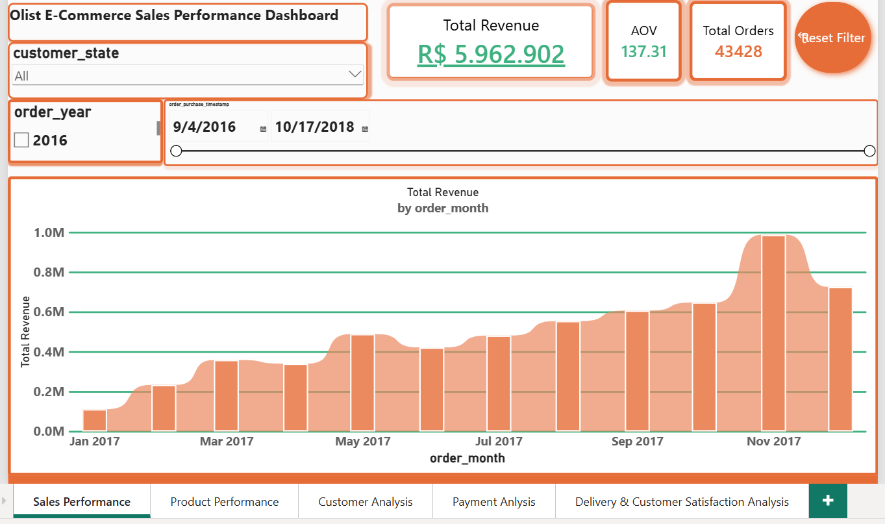
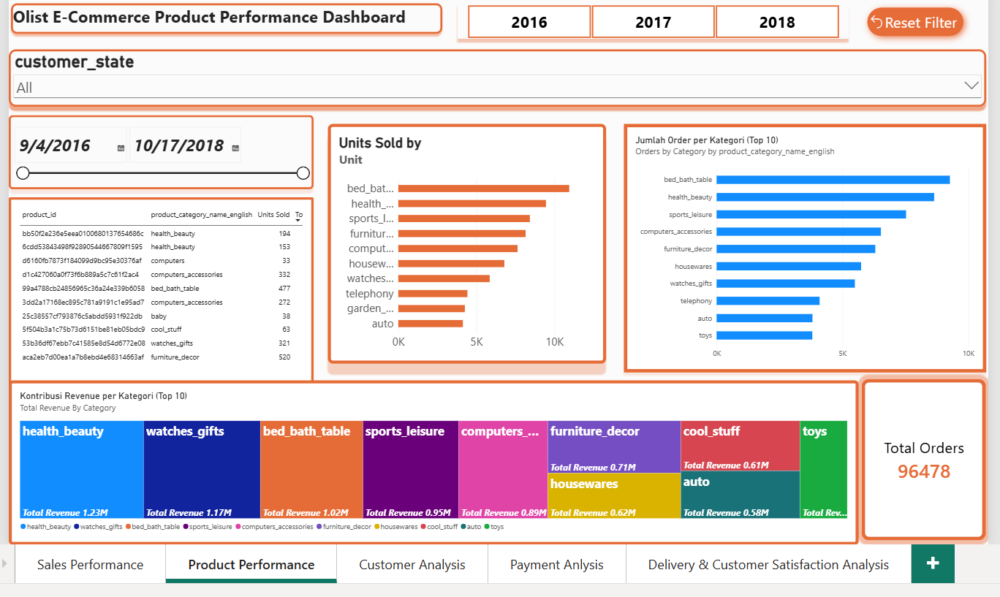
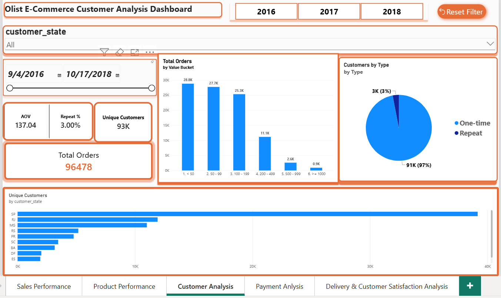
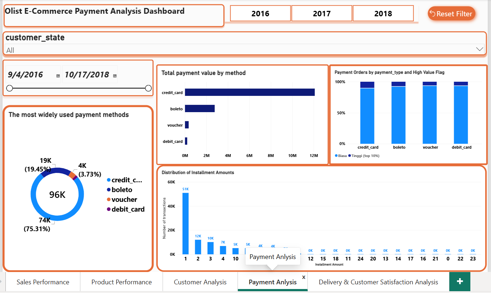
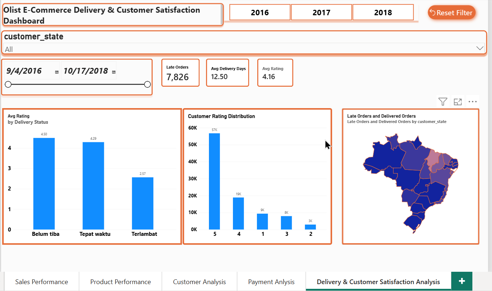

# Olist E-Commerce Analysis

End-to-end analysis of the Olist Brazilian e-commerce dataset using **Python (Pandas), MySQL, and Power BI**: sales, product, customer, payment, and delivery & satisfaction analysis.

## 1. Latar Belakang

Olist adalah marketplace Brasil yang menghubungkan penjual kecil dengan pelanggan di seluruh negeri. Proyek ini menganalisis data transaksi Olist untuk menjawab lima pertanyaan bisnis:

| Analisis | Tujuan |
|---|---|
| A. Sales Performance | Mengetahui performa penjualan |
| B. Product Performance | Mengetahui performa produk dan kategori |
| C. Customer | Memahami perilaku dan sebaran pelanggan |
| D. Payment | Mengetahui metode dan pola pembayaran |
| E. Delivery & Satisfaction | Mengevaluasi pengiriman dan kepuasan pelanggan |

## 2. Dataset

- Sumber: [Brazilian E-Commerce Public Dataset by Olist (Kaggle)](https://www.kaggle.com/datasets/olistbr/brazilian-ecommerce)
- Periode data: **[TANGGAL AWAL] s/d [TANGGAL AKHIR]**
- 9 file CSV yang saling berelasi (orders, order_items, order_payments, order_reviews, customers, products, sellers, category_translation, geolocation). Tabel geolocation tidak dipakai.
- File CSV **tidak diunggah** ke repo (ukuran besar dan lisensi dataset). Unduh dari Kaggle, lalu taruh di `data/raw/`.

## 3. Tools

| Tools | Fungsi |
|---|---|
| Python Pandas | Data cleaning dan EDA |
| MySQL | Database dan SQL analysis |
| Power BI | Dashboard dan visualisasi |
| GitHub | Dokumentasi portofolio |

## 4. Definisi Metrik

- **Revenue** = `SUM(price)` dari `order_items`, hanya order berstatus `delivered` (ongkir dipisah)
- **AOV (rata-rata nilai transaksi)** = revenue / jumlah order unik
- **Pesanan terlambat** = `order_delivered_customer_date` > `order_estimated_delivery_date`
- **Pelanggan unik** = `customer_unique_id` (bukan `customer_id`, yang berbeda untuk tiap pesanan)

## 5. Struktur Repo

```
Project_DA_olist_ecommerce_analysis/
├── data/
│   ├── raw/          # CSV asli dari Kaggle (tidak di-upload)
│   └── clean/        # hasil cleaning (tidak di-upload)
├── notebooks/
│   └── 01_cleaning_eda.ipynb
├── sql/
│   ├── 01_create_tables.sql
│   ├── 01b_load_data.sql
│   ├── 02_sales_analysis.sql
│   ├── 03_product_analysis.sql
│   ├── 04_customer_analysis.sql
│   ├── 05_payment_analysis.sql
│   └── 06_delivery_satisfaction.sql
├── dashboard/        # file .pbix dan screenshot
└── README.md
```

## 6. Alur Kerja

1. **Cleaning & EDA (Python):** memuat dan memeriksa tabel, memperbaiki tipe data, menangani missing value dan duplikat, membuat kolom baru (`order_month`, `delivery_days`, `is_late`), lalu menyimpan hasil bersih.
2. **Database (MySQL):** membuat 7 tabel, mengimpor data bersih dengan `LOAD DATA LOCAL INFILE`, dan menambahkan index pada kolom join.
3. **Analisis (SQL):** satu file query untuk tiap analisis (A sampai E).
4. **Visualisasi (Power BI):** dashboard 5 halaman, satu halaman per analisis.

## 7. Data Cleaning

Keputusan utama saat cleaning (isi dengan angka dari notebook):

1. Dari **[99441]** order, **[96478]** berstatus `delivered`. Status lain (canceled, shipped, dll.) dikeluarkan dari analisis revenue.
2. **[8]** order `delivered` tidak punya tanggal tiba, sehingga dikeluarkan dari analisis pengiriman.
3. **[547]** order punya lebih dari satu review. Diambil review terbaru agar join tidak menggandakan baris.
4. **[610]** produk tanpa kategori diisi `unknown`.
5. **[2]** kategori tanpa terjemahan ditambahkan manual (`pc_gamer`, `portateis_cozinha_e_preparadores_de_alimentos`).
6. Satu order bisa punya banyak item dan banyak baris pembayaran. Semua agregasi memakai `COUNT(DISTINCT order_id)` atau dihitung per order dulu untuk mencegah penghitungan ganda (*fan-out*).

## 8. Temuan Utama

### A. Sales Performance
- Total revenue **R$ 13221498.11** dari **[96.478]** order, dengan AOV **R$ 137.04**.
- Bulan dengan revenue tertinggi: **[November 2017]** (R$ 987.765,37).
- Tren: - Tren: revenue **naik hampir terus-menerus sepanjang 2017**, dari sekitar R$ 0,1 juta pada Januari 2017 hingga puncak **R$ 987.765,37 pada November 2017**. Setelah turun di Desember 2017 (sekitar R$ 0,72 juta), revenue **cenderung stabil** di kisaran R$ 0,82 sampai 0,97 juta per bulan sepanjang 2018 (sampai Agustus). Data 2016 dan September sampai Oktober 2018 tidak lengkap, jadi penurunan di ujung periode bukan penurunan bisnis.

### B. Product Performance
- Kategori terlaris berdasarkan unit: **'bed_bath_table'** (10.953 unit).
- Kategori dengan revenue tertinggi: **'health_beauty'** (R$'1.233.131,72' , 9,33% dari total).
- Perbedaan keduanya disebabkan harga rata-rata per unit: **R$ 93,44** vs R$ **130,28**.
- **18** kategori teratas menyumbang 80% revenue.

### C. Customer
- Jumlah pelanggan unik: **93.358**.
- Wilayah terbanyak: **São Paulo** (41,94% pelanggan), disusul **Rio de Janeiro** dan **Minas Gerais**.
- Nilai order paling banyak berada di rentang **di bawah R$ 100** (**58,58%** dari seluruh order), dengan rata-rata R$**137,04**.
- Pelanggan repeat hanya **3%**, menandakan retensi yang rendah.

### D. Payment
- Metode paling banyak: **credit card** (75,31% order), menyumbang 77,02% total nilai.
- Cicilan paling umum: **1x**. Cicilan panjang (6x atau lebih) lebih sering muncul pada transaksi bernilai besar. **YA** (47,63% pada kelompok tinggi vs 12,62% pada kelompok biasa).
- Pada transaksi bernilai tinggi (10% teratas), metode dominan adalah **credit card** (81,53%).

### E. Delivery & Customer Satisfaction
- Rata-rata waktu pengiriman **12,5 hari** (estimasi rata-rata 24,4 hari).
- **8,11%** pesanan terlambat dari estimasi.
- Rating pesanan tepat waktu **4,29** vs pesanan terlambat 1-3 hari **3,59**. Semakin lama keterlambatan, semakin rendah rating.
- Rata-rata rating keseluruhan: **4,16**.
- State dengan keterlambatan tertinggi: **Maranhão (MA), dengan 19,67% terlambat** dan **Ceará, dengan 15,32% terlambat (CE)** dari kesuluruhan total dengan dibandingkan rata-rata nasional **8,11%**.

## 9. Dashboard

### Dashboard Preview








| Halaman | Isi |
|---|---|
| Sales | KPI revenue, order, AOV, tren bulanan |
| Product | Top kategori, kontribusi revenue |
| Customer | Sebaran state, repeat vs one-time |
| Payment | Metode bayar, distribusi cicilan |
| Delivery | Waktu kirim, late rate, rating vs keterlambatan |

<!--  -->

## 10. Rekomendasi Bisnis

1. **Perbaiki logistik di [STATE]** yang keterlambatannya tertinggi, karena keterlambatan berkaitan dengan rating rendah.
2. **Dorong pembelian ulang** (voucher, email pasca-pembelian), karena hanya [X]% pelanggan yang membeli lebih dari sekali.
3. **Fokus pada kategori bernilai tinggi** seperti [KATEGORI], yang memberi revenue besar dengan unit lebih sedikit.
4. **Tawarkan cicilan** pada produk bernilai besar, karena [X]% transaksi bernilai tinggi memakai cicilan.

## 11. Keterbatasan

- Data 2016 sangat sedikit dan akhir 2018 tidak lengkap, sehingga angka tren di periode itu tidak mencerminkan kondisi bisnis sebenarnya.
- `customer_unique_id` tidak sempurna mengidentifikasi pelanggan yang sama, jadi persentase repeat adalah perkiraan.
- Tidak ada data biaya, sehingga profit tidak bisa dihitung. Analisis hanya sampai revenue.
- Rating hanya berasal dari order yang direview. Hubungan keterlambatan dan rating adalah korelasi, bukan bukti sebab-akibat.
- `payment_value` sudah termasuk ongkir, jadi total pembayaran lebih besar dari revenue.

## 12. Cara Menjalankan Ulang

1. Unduh dataset dari Kaggle ke `data/raw/`.
2. Jalankan `notebooks/01_cleaning_eda.ipynb` (menghasilkan `data/clean/`).
3. Di MySQL, jalankan `sql/01_create_tables.sql`, lalu `sql/01b_load_data.sql` (aktifkan `local_infile`, sesuaikan path file).
4. Jalankan `sql/02` sampai `sql/06` untuk analisis A sampai E.
5. Buka file `.pbix` di `dashboard/` dengan Power BI Desktop.

## 13. Author

**Ilham Notohusodo**, [GitHub](https://github.com/IlhamNotohusodo)
